# AetherPub: System Architecture & Agent Engineering Guide

> **Notice for Future AI Agents & Engineers**:  
> This document is the definitive architectural manual for **AetherPub**. Read this document before proposing or applying code changes, adding new features, or refactoring existing pipelines.

---

## 1. System Vision & Non-Negotiables

AetherPub is a self-hosted, automated web-to-EPUB periodical engine built specifically for e-reader devices (Kindle, Kobo, Boox, reMarkable) with a reactive, cyberpunk-inspired dark WebUI.

### Core Non-Negotiable Invariants
1. **Zero-Node Runtime Dependency**:
   - The application **must not** require a Node.js/npm build pipeline. The WebUI is served directly by FastAPI as a modular Single Page Application (SPA) using CDN-loaded Tailwind CSS, Lucide icons, and vanilla ES6 modules.
   - Startup command must always remain: `python run.py`.
2. **Color E-Ink Preservation**:
   - Images in extracted articles **must retain full RGB color channels**. Do **not** convert images to 8-bit grayscale. Color e-ink screens (Kaleido 3, Gallery 3, reMarkable Paper Pro) and tablets depend on RGB diagrams, photographs, and infographics. Oversized images are downscaled to $\le 1600\text{px}$ JPEG (quality 85).
3. **EPUB 3 Strict Compliance & Dual Table of Contents**:
   - EPUBs generated by this system must strictly conform to IDPF EPUB 3.2 standards.
   - Every compiled book **must include both** EPUB 3 `nav.xhtml` and legacy EPUB 2 `toc.ncx` to guarantee navigation compatibility across all Kindle firmware revisions and third-party readers (KOReader, Moon+ Reader, Calibre).
4. **Hexadecimal SimHash Integrity**:
   - The `content_hash` field on `Article` is a 64-bit hexadecimal SimHash string (`f"{fingerprint:016x}"`). Never assign non-hex strings (e.g. `'hash_test'`) to this field.
5. **Strict UI Design System Compliance**:
   - Any frontend changes or new visual features must strictly follow the rules in [UI_DESIGN_SYSTEM.md](UI_DESIGN_SYSTEM.md) (Cyberpunk Obsidian dark theme, OLED black `#09090b`, glassmorphic panels, specific neon accent semantics, and zero Node build-steps).

---

## 2. High-Level Architecture

```mermaid
flowchart TB
    subgraph Client ["Frontend Client (Browser)"]
        UI["Cyberpunk Dark WebUI<br/>(Tailwind v3, Lucide, ES6)"]
        SSEListener["EventSource Client<br/>(/api/v1/events/stream)"]
    end

    subgraph Server ["FastAPI Application Gateway (Port 8000)"]
        Router["/api/v1 REST Router"]
        EventBus["Async In-Memory EventBus<br/>(Pub-Sub Broadcast)"]
        Scheduler["AsyncIOScheduler (APScheduler)<br/>(Daily Cron Runner)"]
        
        subgraph Pipeline ["Curation & Extraction Pipeline"]
            Discovery["DiscoveryService<br/>(RSS / Atom / Sitemap / HTML)"]
            Readability["ReadabilityService<br/>(Trafilatura + LXML XHTML Cleaner)"]
            ImageProc["ImageProcessor<br/>(Pillow RGB Downscaler, Max 1600px)"]
            Scorer["KeywordScorer & SimHash<br/>(3x Title Weight, Exclusions, 64-bit Hash)"]
            Compiler["EPUBGenerator & CoverGen<br/>(EbookLib + Pillow Procedural Cover)"]
            SMTP["SMTPDeliveryService<br/>(aiosmtplib Amazon Send-to-Kindle)"]
        end

        DB[(SQLite: storage/aetherpub.db<br/>SQLAlchemy 2.0 Async)]
        Vault[(File Vault: storage/epubs, covers, media)]
    end

    subgraph Device ["Destination"]
        Kindle["Amazon Kindle / E-Reader<br/>(Via SMTP or Browser Download)"]
    end

    UI <-->|"REST API"| Router
    SSEListener <-->|"Server-Sent Events"| EventBus
    Pipeline --> DB
    Pipeline --> Vault
    Pipeline -.->|"Broadcast Milestones"| EventBus
    Compiler --> Device
    SMTP --> Device
```



---

## 3. Directory Layout & Module Responsibilities

```
agyplayground/
├── backend/
│   ├── app/
│   │   ├── api/
│   │   │   ├── endpoints/
│   │   │   │   ├── articles.py       # Browse, filter & view extracted HTML
│   │   │   │   ├── editions.py       # List, download, build & email EPUBs
│   │   │   │   ├── events.py         # SSE /api/v1/events/stream endpoint
│   │   │   │   ├── keywords.py       # CRUD & live scoring sandbox evaluation
│   │   │   │   ├── settings.py       # Schedule, SMTP credentials & pipeline trigger
│   │   │   │   └── sources.py        # Probe, register, crawl & delete sources
│   │   │   └── router.py             # Main /api/v1 router aggregation
│   │   ├── core/
│   │   │   ├── config.py             # Pydantic Settings, paths, defaults
│   │   │   ├── database.py           # SQLAlchemy async engine, sessionmaker, init_db
│   │   │   └── event_bus.py          # Async queue pub-sub for SSE
│   │   ├── models/
│   │   │   └── entities.py           # SQLAlchemy 2.0 ORM models (Source, Keyword, Article, DailyEdition)
│   │   ├── schemas/
│   │   │   └── api_models.py         # Pydantic v2 request/response schemas
│   │   ├── services/
│   │   │   ├── crawler/
│   │   │   │   ├── discovery.py      # RSS, Atom, and shallow link heuristic detector
│   │   │   │   └── fetcher.py        # Resilient httpx client with polite delay
│   │   │   ├── curator/
│   │   │   │   ├── scorer.py         # Weighted keyword scorer & breakdown generator
│   │   │   │   └── simhash.py        # 64-bit SimHash, Hamming distance, duplicate check
│   │   │   ├── delivery/
│   │   │   │   └── smtp_client.py    # aiosmtplib Send-to-Kindle dispatcher & handshake tester
│   │   │   ├── epub/
│   │   │   │   ├── cover_generator.py # Pillow 1600x2400 procedural cover generator
│   │   │   │   ├── generator.py      # EbookLib EPUB 3 compiler & spine builder
│   │   │   │   └── stylesheet.py     # E-ink typography CSS rules
│   │   │   ├── extractor/
│   │   │   │   ├── image_processor.py # RGB color preservation & image path rewriter
│   │   │   │   └── readability.py    # Trafilatura article extractor + clean XHTML
│   │   │   └── scheduler/
│   │   │       └── runner.py         # Orchestrator: ingest_source, compile_daily_edition, cron
│   │   └── main.py                   # FastAPI app declaration, lifespan, static mounting
│   └── tests/                        # Pytest automated test suite
├── frontend/
│   └── static/
│       ├── css/
│       │   └── custom.css            # Cyberpunk dark glassmorphism & reader typography
│       ├── js/
│       │   └── app.js                # Reactive SPA controller, SSE listeners, modals
│       └── index.html                # Single-page dashboard HTML
├── storage/                          # Runtime persistent storage (gitignored)
│   ├── covers/                       # Cover JPEG files (.gitkeep)
│   ├── epubs/                        # Generated .epub files (.gitkeep)
│   └── media/                        # Cached article images (.gitkeep)
├── requirements.txt                  # Python dependencies
├── run.py                            # Application launcher script
└── README.md                         # User documentation
```

---

## 4. Key Subsystems & Implementation Details

### 4.1 Ingestion & Extraction (`services/crawler/` & `services/extractor/`)
- **Auto-Discovery Flow**:
  1. Fetches site root URL.
  2. Inspects `<link rel="alternate" type="application/rss+xml">` or `atom+xml`.
  3. If missing, probes common endpoints: `/feed`, `/rss`, `/atom.xml`, `/rss.xml`, `/feed.xml`.
  4. If still missing, falls back to shallow link discovery across `<article>` and `<a>` elements within the same domain.
- **Readability & XHTML Sanitization**:
  - `Trafilatura` is used with `output_format="xml"`.
  - Strips dangerous/unrenderable elements (`<script>`, `<style>`, `<iframe>`, `<form>`).
  - Generates plain text, word counts, and an excerpt.
  - Generates a 64-bit hexadecimal SimHash for syndication deduplication.
- **Image Optimization (Color E-Ink)**:
  - Scans `` elements in clean HTML.
  - Converts transparency modes (`RGBA`, `LA`, `P`) into `RGB` over a pure white background.
  - Downscales oversized images exceeding $1600\text{px}$ width/height using `Image.Resampling.LANCZOS`.
  - Re-encodes as RGB JPEG (`quality=85`).
  - Rewrites `img src` to relative internal EPUB paths (`images/art_{id}_{index}.jpg`).

### 4.2 Curation & Scoring Matrix (`services/curator/`)
- **Composite Scoring Formula**:
  $$\text{Score} = \max\left(0.0, \text{Score}_{\text{keywords}} + \text{Weight}_{\text{source}} + \text{Weight}_{\text{age}}(d) + \text{Weight}_{\text{length}}(w)\right)$$
  Where:
  $$\text{Score}_{\text{keywords}} = \sum_{k \in \text{Weighted Keywords}} k.\text{weight} \times \left(3.0 \times \text{TitleHits}(k) + 1.0 \times \text{BodyHits}(k)\right)$$
  - $\text{Weight}_{\text{source}}$: Source-level bias applied to all articles from the feed.
  - $\text{Weight}_{\text{age}}(d)$: Piecewise linear interpolation of user-defined age curve (days).
  - $\text{Weight}_{\text{length}}(w)$: Piecewise linear interpolation of user-defined article length curve (words).
- **Exclusion Check (`is_excluded=True`)**:
  - If any excluded keyword matches title or body, score is set to `-1.0` and the article is immediately discarded.
- **Required Check (`is_required=True`)**:
  - If a required keyword is missing, score is set to `0.0` (will not be bundled).
- **SimHash Deduplication**:
  - `hamming_distance(hash1, hash2) <= 3` flags an article as a near-duplicate, skipping ingestion.
  - `hamming_distance` catches `ValueError`/`TypeError` defensively to prevent unparseable strings from interrupting crawler jobs.

### 4.3 EPUB 3 Generation (`services/epub/`)
- **Procedural Cover Art (`cover_generator.py`)**:
  - Dimensions: $1600 \times 2400\text{px}$ RGB.
  - System font discovery order: `segoeui.ttf` $\rightarrow$ `arial.ttf` $\rightarrow$ `calibri.ttf` $\rightarrow$ `DejaVuSans.ttf` $\rightarrow$ Pillow default.
  - Renders masthead, date emblem, article count, and topics summary.
- **EPUB Structure (`generator.py`)**:
  - Adds Dublin Core metadata: UUID identifier, title, language, author, date.
  - Injects `style/eink.css`: serif body fonts, justified alignment, fluid margins, high-contrast code blocks, page-break controls (`break-before: page; page-break-inside: avoid;`).
  - Embeds all color images in the EPUB manifest.
  - Compiles both EPUB 3 `nav.xhtml` and legacy EPUB 2 `toc.ncx`.

### 4.4 Send-to-Kindle SMTP (`services/delivery/`)
- Uses `aiosmtplib` with `EmailMessage`.
- Handles Amazon Send-to-Kindle requirements:
  - Whitelisted `From:` address matching user settings.
  - Subject set to edition title.
  - Attachment MIME type: `application/epub+zip` with `.epub` extension.
  - Supports TLS (port 587 STARTTLS) and SSL (port 465).

### 4.5 Reactive WebUI & Real-Time Telemetry
- **Single-Page Architecture**:
  - HTML located at `frontend/static/index.html`.
  - App controller at `frontend/static/js/app.js`.
  - Styles at `frontend/static/css/custom.css`.
- **Server-Sent Events Channel (`/api/v1/events/stream`)**:
  - Real-time event broker streaming events: `crawler:source_started`, `article:ingested`, `compiler:started`, `compiler:completed`, `smtp:sent`, `smtp:failed`.
  - Terminal console auto-scrolls and maintains the last 200 log messages.

---

## 5. Development & Testing Guide

### 5.1 Environment Setup (Windows / Linux)
```powershell
# Install dependencies
python -m pip install -r requirements.txt

# Run server in development mode
python run.py
```
Default URL: `http://127.0.0.1:8000`  
Interactive API Docs (Swagger): `http://127.0.0.1:8000/docs`

### 5.2 Running Automated Tests
```powershell
python -m pytest tests/ -v
```

### 5.3 Test Suite Inventory
- `tests/test_api.py`: Tests `/health`, keyword CRUD, and sandbox evaluation.
- `tests/test_curator.py`: Tests SimHash calculation, Hamming distance resilience, and weighted scoring.
- `tests/test_epub.py`: Tests procedural cover generation, EPUB 3 container structure, and valid ZIP manifest.
- `tests/test_extractor.py`: Tests Trafilatura article extraction and RGB color image preservation.
- `tests/test_pipeline_e2e.py`: Tests end-to-end ingestion, scoring, and EPUB compilation with database cleanup.

---

## 6. How-To Extension Recipes

### Recipe 1: How to Add a New Delivery Channel (e.g., OPDS Catalog)
1. Create `backend/app/api/endpoints/opds.py`.
2. Construct an Atom/XML catalog feed listing compiled `DailyEdition` records with links to `/api/v1/editions/{id}/download`.
3. Include the router in `backend/app/api/router.py`:
   ```python
   from backend.app.api.endpoints.opds import router as opds_router
   api_router.include_router(opds_router)
   ```
4. Expose the feed at `/api/v1/opds/catalog.xml`.

### Recipe 2: How to Add Custom Extractor Rules for Paywalled or JavaScript Blogs
1. Open `backend/app/services/extractor/readability.py`.
2. In `ReadabilityService.extract_article()`, add custom parsing logic based on `urlparse(url).netloc` before the general Trafilatura fallback.
3. Ensure the extracted output is returned as sanitized XHTML string with `<div class="article-content">` wrapper.

### Recipe 3: How to Modify E-Ink CSS Typography
1. Open `backend/app/services/epub/stylesheet.py`.
2. Modify `EINK_STYLESHEET`.
3. Keep relative units (`rem`, `em`, `%`) and avoid hardcoded pixel heights or fixed positioning which crash e-reader pagination engines.

---

## 7. Common Pitfalls & Guardrails for Future Agents

> [!WARNING]
> **Database Locks with SQLite & Async**:
> SQLite handles concurrent reads gracefully, but concurrent write operations must be awaited in sequence. Use `AsyncSessionLocal()` with standard context managers (`async with AsyncSessionLocal() as session:`) and commit transactions promptly.

> [!IMPORTANT]
> **SimHash Value Validation**:
> Never assign arbitrary strings to `Article.content_hash`. Always use `compute_simhash(text)` or a valid 16-hex string (`uuid.uuid4().hex[:16]`). The deduplication engine relies on 64-bit integer bitwise XOR.

> [!CAUTION]
> **Avoid Node.js or Webpack Toolchains**:
> Do not introduce `npm`, `package.json`, or frontend bundlers into the root directory unless explicitly requested by the user. The simplicity of zero-dependency static file serving from FastAPI is a primary design goal.
