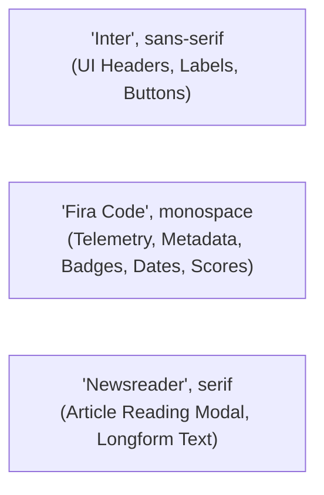

# AetherPub: UI & UX Design System Specification

> **Mandatory Standard for AI Agents & Frontend Contributors**:  
> This document specifies the strict visual language, design tokens, component anatomy, and UX interaction patterns for **AetherPub**. Any agent or developer adding new views, modals, cards, or controls **must** adhere strictly to these rules to preserve the aesthetic consistency of the application.

---

## 1. Visual Theme & Philosophy

- **Aesthetic**: **Cyberpunk Obsidian & Dark Glassmorphism**.
- **Foundational Mood**: High-tech, nocturnal, minimalist, and responsive. It evokes an advanced e-reader laboratory or tactical reader terminal.
- **Strict Rule on Theme**: **No light mode**. AetherPub is an OLED-first, dark-only interface. Never add white or light-gray card backgrounds.

---

## 2. Color Palette & Design Tokens

### 2.1 Core Surfaces & Backgrounds
| Token / Utility | Hex Code | Role / Usage |
| :--- | :--- | :--- |
| `bg-zinc-950` / `--bg-main` | `#09090b` | Root viewport background, canvas, reader backdrop |
| `bg-zinc-900` / `--card-bg` | `#121217` / `rgba(18, 18, 24, 0.75)` | Glassmorphic panel surfaces, modals, popovers |
| `bg-zinc-800` | `#1c1c24` | Secondary interactive containers, inputs, table rows |
| `border-white/10` / `--card-border` | `rgba(255, 255, 255, 0.08)` | Default glassmorphism hairline borders |
| `border-white/5` | `rgba(255, 255, 255, 0.04)` | Subtle dividers, secondary row separators |

### 2.2 Neon Accent Lights & Semantics
Every color has a dedicated functional meaning. Do not interchange them arbitrarily.

| Color | Hex / Tailwind | Semantic Meaning & UI Role |
| :--- | :--- | :--- |
| **Electric Cyan** | `#06b6d4` (`cyan-400` / `cyan-500`) | **Ingestion, Discovery & Primary Action**: Crawling, source URLs, primary buttons, brand glow. |
| **Neon Violet** | `#8b5cf6` (`violet-400` / `violet-600`) | **Curation, Compilation & Reading**: EPUB building, reader modal, chapter badges, SMTP dispatch. |
| **Emerald Green** | `#10b981` (`emerald-400` / `emerald-500`) | **System Health & Required Rules**: "Online/Idle" pulse, successful completion, `[+] REQUIRED` keywords. |
| **Vivid Rose** | `#f43f5e` (`rose-400` / `rose-500`) | **Exclusions & Destructive Actions**: Delete buttons, error toasts, `[-] EXCLUDED` keywords, crawl failures. |
| **Warm Amber** | `#f59e0b` (`amber-400` / `amber-500`) | **Warnings & In-Progress States**: Telemetry warnings, unsaved states, unassigned quota notices. |

---

## 3. Typography Rules

AetherPub uses a tri-font hierarchy to cleanly segregate interface controls, technical telemetry, and long-form literature.



1. **Interface Headings & Controls**: `'Inter', sans-serif`
   - Page Titles: `text-xl font-bold text-white`
   - Section Headings: `text-sm font-semibold text-white`
   - Button Labels: `text-xs font-semibold`
2. **Metadata & Machine Outputs**: `'Fira Code', monospace` (`font-mono`)
   - Timestamps, URLs, numbers, score badges, status pills, terminal logs.
   - Example: `text-xs font-mono text-zinc-400`
3. **E-Reader Long-form Reading**: `'Newsreader', serif` (`reader-body` / `font-serif`)
   - Line height: `line-height: 1.8`
   - Font size: `1.15rem`
   - Text color: `#f1f5f9` (soft off-white to prevent eye strain)
   - Paragraph alignment: `text-justify` with `margin-bottom: 1.25rem`

---

## 4. Component Anatomy & CSS Standards

### 4.1 Glassmorphic Cards (`.glass-panel`)
Every card, metric box, and settings panel must use the standard `.glass-panel` class:
```html
<div class="glass-panel p-5 rounded-xl">
    <!-- Content -->
</div>
```
- **CSS definition**:
  ```css
  .glass-panel {
      background: rgba(18, 18, 24, 0.75);
      backdrop-filter: blur(16px);
      border: 1px solid rgba(255, 255, 255, 0.08);
      transition: all 0.25s cubic-bezier(0.16, 1, 0.3, 1);
  }
  .glass-panel:hover {
      border-color: rgba(6, 182, 212, 0.3);
      box-shadow: 0 8px 30px rgba(0, 0, 0, 0.6), 0 0 15px rgba(6, 182, 212, 0.1);
  }
  ```

### 4.2 Action Buttons
1. **Primary Glowing Cyan (Discovery / Add)**:
   ```html
   <button class="px-4 py-2 rounded-lg bg-cyan-500 hover:bg-cyan-400 text-black font-semibold text-xs flex items-center gap-1.5 transition-all shadow-lg shadow-cyan-500/20">
       <i data-lucide="plus" class="w-4 h-4"></i> Add Website
   </button>
   ```
2. **Primary Glowing Violet (Compilation / Digest)**:
   ```html
   <button class="px-4 py-2 rounded-lg bg-gradient-to-r from-violet-600 to-indigo-600 hover:from-violet-500 hover:to-indigo-500 text-white text-xs font-mono font-semibold flex items-center gap-1.5 transition-all shadow-lg shadow-violet-600/30">
       <i data-lucide="layers" class="w-4 h-4"></i> Compile Digest Now
   </button>
   ```
3. **Ghost / Sub-action**:
   ```html
   <button class="px-3 py-1.5 rounded-lg bg-zinc-900 hover:bg-zinc-800 border border-zinc-700 text-zinc-300 text-xs font-mono flex items-center gap-1.5 transition-all">
       <i data-lucide="refresh-cw" class="w-3.5 h-3.5 text-cyan-400"></i> Refresh
   </button>
   ```
4. **Destructive / Delete Icon Button**:
   ```html
   <button class="p-1.5 text-zinc-500 hover:text-rose-400 hover:bg-rose-950/40 rounded transition-all" title="Delete">
       <i data-lucide="trash-2" class="w-4 h-4"></i>
   </button>
   ```

### 4.3 Badges & Chips
- **Weighted Keyword Chip**:
  `bg-cyan-950/60 border border-cyan-800/80 text-cyan-300 font-mono text-xs px-2.5 py-1 rounded-lg`
- **Required Keyword Chip**:
  `bg-emerald-950/60 border border-emerald-800 text-emerald-300 font-mono text-xs px-2.5 py-1 rounded-lg` (Must include prefix `[+] REQUIRED:`)
- **Excluded Keyword Chip**:
  `bg-rose-950/60 border border-rose-800 text-rose-300 font-mono text-xs px-2.5 py-1 rounded-lg` (Must include prefix `[-] EXCLUDED:`)
- **System Status Badge (Idle)**:
  `bg-zinc-800 text-zinc-400 border border-zinc-700 text-xs font-mono uppercase px-2 py-0.5 rounded`
- **System Status Badge (Active/Crawling)**:
  `bg-cyan-950/60 text-cyan-400 border border-cyan-800 animate-pulse text-xs font-mono uppercase px-2 py-0.5 rounded`

### 4.4 Form Inputs
All form inputs (text, number, select, textarea) must follow this consistent visual spec:
```html
<input 
    type="text" 
    class="w-full bg-zinc-900 border border-zinc-700 rounded-lg px-3 py-2 text-xs text-white placeholder-zinc-500 focus:outline-none focus:border-cyan-500 transition-colors"
/>
```

### 4.5 Live Telemetry Drawer (Cyberpunk Console)
The terminal console is a critical reactive element:
- Background: `bg-zinc-950/90` with border `border-zinc-800`.
- Header: Simulated macOS/terminal traffic lights (`bg-rose-500/80`, `bg-amber-500/80`, `bg-emerald-500/80`).
- Text streaming lines:
  - Info log: `text-zinc-300 font-mono text-xs`
  - Success event: `text-cyan-400 font-mono text-xs font-medium`
  - Warning event: `text-amber-400 font-mono text-xs`
  - Error event: `text-rose-400 font-mono text-xs font-medium`

---

## 5. Modal Dialogs

Every modal dialog follows a standardized geometry:
1. **Backdrop**: `fixed inset-0 z-50 bg-black/80 backdrop-blur-md flex items-center justify-center p-4`
2. **Container**: `glass-panel w-full max-w-lg rounded-2xl p-6 border border-white/10 shadow-2xl relative`
3. **Header**: Title in `text-base font-bold text-white flex items-center gap-2` with close button `text-zinc-500 hover:text-white`.
4. **Body**: Spaced `space-y-4 text-xs`.
5. **Preview Panel**: If probing or evaluating, results must render in a nested `bg-zinc-950 border border-zinc-800 rounded-xl p-4` card.

---

## 6. Icons & Assets

- **Icon Set**: **Lucide Icons** exclusively (`https://unpkg.com/lucide@latest`).
- **Icon Sizing**:
  - Buttons / inline labels: `w-3.5 h-3.5` or `w-4 h-4`
  - Empty state / hero icons: `w-10 h-10 text-zinc-600`
- **Dynamic Re-initialization Rule**:
  Whenever vanilla JavaScript inserts HTML containing `<i data-lucide="...">`, it **must** immediately call:
  ```javascript
  lucide.createIcons();
  ```
  Failure to call this results in invisible icons.

---

## 7. Golden Rules for Future AI Agents

1. **Never Inject Light Mode**: Any attempt to add white backgrounds, black text for primary surfaces, or gray border lines ($> \text{zinc-700}$) violates the visual design.
2. **Never Add Build Steps**: Do not create a `webpack.config.js`, `vite.config.ts`, or `package.json` in the root unless explicitly commanded by the user. Keep all frontend assets static and served directly via FastAPI.
3. **Keep Real-Time Feedback**: Any asynchronous operation (crawling, scoring, compiling, emailing) **must** emit an SSE event to `event_bus.emit(event_type, payload)` so the live terminal console and pulse indicators react visually.
4. **Preserve Color Graphics**: In any e-reader or preview component, color channels must be retained. Do not add grayscale CSS filters (`grayscale(100%)`) to reader image tags.
5. **Maintain Micro-Animations**: Use `transition-all duration-200` on buttons, inputs, and card hovers. Avoid abrupt, un-transitioned hover jumps.
